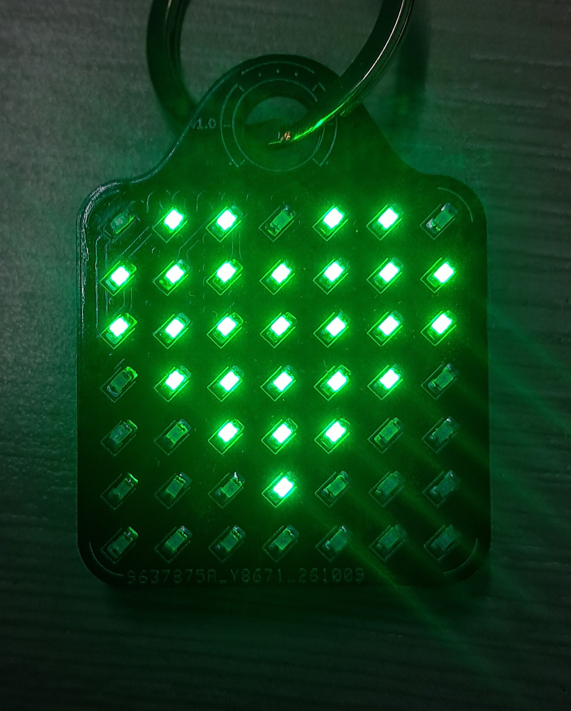
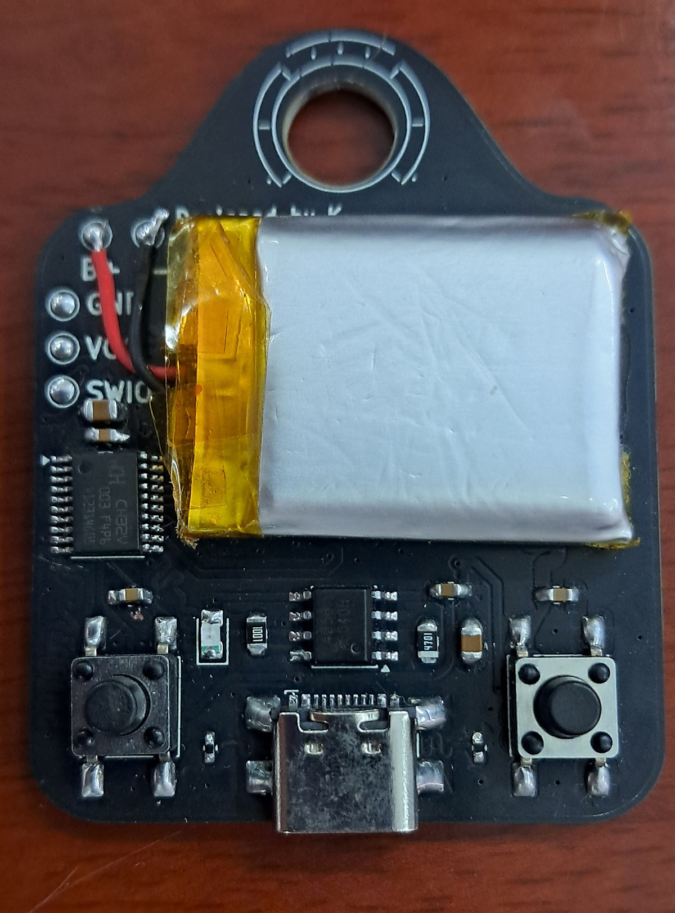

# TinyKey

A keychain with 49 LEDs on the front and a ten cent MCU doing the work.

<p align="center"></p>

I built this because I wanted to find out how much display you can get out of a
microcontroller that costs less than a coffee. The answer, it turns out, is a
49 LED matrix you can scroll text on, carry in your pocket, and charge from
USB-C. The whole thing runs on a CH32V003, the chip WCH sells for about ten
cents.

## Why a ten cent MCU

The CH32V003F4P6 is a real 32-bit part, not a toy: RISC-V core at 48 MHz, 16 kB
of flash, 2 kB of RAM, 18 GPIOs, plus UART, I2C, SPI and a 10-bit ADC, all in a
TSSOP-20. It has no USB, no crystal, no external memory and no display
controller. Everything it does, it does with pins and time.

That is exactly what makes it interesting. A 7x7 matrix needs 14 pins and 25
bytes of frame buffer at 4 bits per LED. The scan loop has to keep a fixed
frame time or the brightness wobbles. The chip has just enough of all three,
and the firmware that drives the display is under 9 kB, so half the flash is
still empty.

The price is what changes the design. Ten cents is less than the LEDs it
drives, so you stop designing around the chip and start designing around the
display. There is no budget for an LED driver IC either, which is why the
matrix hangs straight off the GPIOs with no series resistors, and the current
limit comes from the 2 MHz GPIO drive setting rather than from parts.

What that costs you is software: you write the row scan, tune the duty cycle,
and find out that skipping an empty row shows up as a brightness jump while text
scrolls. That is the whole trade, and it is a good one. The board ends up small
and cheap, and the thing you spend is a weekend of pin twiddling.

## V1 or V2?

There are two revisions and they are easy to mix up. The photos are V1, the
files in `hardware/` are V2, and V2 has never been manufactured.

| | V1 | V2 |
|---|---|---|
| Shown in | the photos below | the 3D renders and PDFs |
| Board file | `hardware/archive/TinyKeyV1.kicad_pcb` | `hardware/TinyKey.kicad_pcb` |
| Built | yes, it runs | no, files only |
| Size | 40 x 52 mm | 35 x 45.4 mm |
| What changed | the prototype | tighter outline, ground pours redone, DRC clean |

If you want to order a board, use V2. The photos are just what the thing looks
like assembled, with a cell and a keyring on it.

## The hardware

Front: 49 0805 LEDs wired as 7 anode rows and 7 cathode columns, 14 GPIOs in
total. Back: the MCU, the charger, USB-C (power only, the data pins go nowhere),
two buttons, SWIO pads for programming and B+/B- for the cell. Two layers, no
series resistors on the matrix, current limited by keeping the GPIO drive at
2 MHz.

Two things I learned the hard way:

- The first batch came back with all 49 LEDs soldered backwards. Instead of
  reworking 49 parts I flipped the drive polarity in firmware: a lit LED is
  anode LOW, cathode HIGH. It still works that way.
- The row scan needs a fixed 7 step frame. Skipping empty rows makes the
  brightness pump while text scrolls.

And one trap: BTN1 sits on PD7, which is NRST from the factory. Write the option
bytes (`USER = 0x1F`) or the button reboots the chip instead of changing effect.
The bytes and commands are in
[docs/hardware.md](docs/hardware.md#pd7-is-nrst-by-default).

| Front, 49 LEDs lit | Back, cell taped over the charger |
|---|---|
|  |  |

Everything for ordering: [schematic PDF](docs/hardware/TinyKey-schematic.pdf),
[PCB top](docs/hardware/TinyKey-pcb-top.pdf) and
[bottom](docs/hardware/TinyKey-pcb-bottom.pdf) PDFs,
[gerbers](hardware/gerbers), [fab zip](hardware/TinyKeyV2_gerbers.zip),
[BOM](hardware/bom.csv), KiCad [project](hardware/).

## The software

`firmware/arduino/tinykey_v2` is the current sketch, on the WCH Arduino core. It
does 15 step software PWM per LED, so it can fade and scroll text sub-pixel.
Eight effects: text, wave, ripple, rain, heart, bounce, chevron, and a face that
blinks, because a 7x7 display deserves a face.

`firmware/c` is the smaller ch32v003fun build. One C file, 14 effects, no
Arduino layer, and the one that first ran on the board. BTN1 cycles effects and
BTN2 sleeps, though BTN2 was flaky on my prototype, so treat sleep as a bonus.

### Build and flash

```bash
# Arduino firmware
arduino-cli compile --fqbn WCH:ch32v:CH32V00x_EVT:pnum=CH32V003F4 \
  --output-dir out firmware/arduino/tinykey_v2
timeout 30 minichlink -w out/tinykey_v2.ino.bin flash -b

# C firmware (riscv-none-elf-gcc, ch32v003fun as a sibling directory)
cd firmware/c
make
make flash
```

There is no USB bootloader, so SWIO and a WCH-Link are the only way in. Prebuilt
binaries are in [prebuilt/](prebuilt/), and the Windows driver setup plus the
option bytes are covered in [docs/flashing.md](docs/flashing.md).

## Repo layout

`firmware/arduino/tinykey_v2/` is the current sketch and `firmware/c/` the
ch32v003fun one. `bringup/` and `firmware/arduino/legacy/` are history.
`hardware/` holds the KiCad project, gerbers, BOM and archived revisions,
`docs/` the pin map, flashing and photo notes, `host/` and `tools/` the WinUSB
helper and flash scripts, `prebuilt/` the binaries.

## Status

V1 works. V2 is files and gerbers, not silicon. The Arduino sketch compiles to
8932 B of 16 kB. The prebuilt binaries came from these sources, but I have not
tried them on anyone else's board.

MIT, see [LICENSE](LICENSE).
