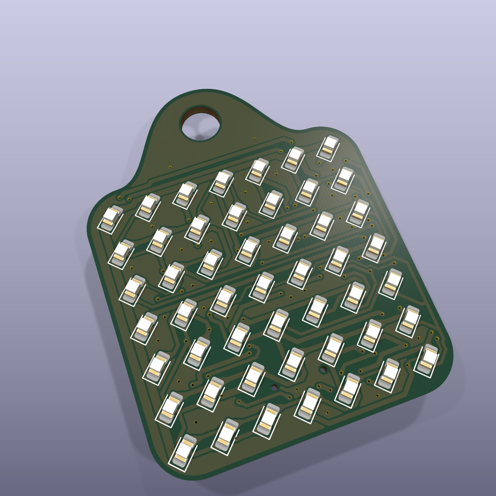
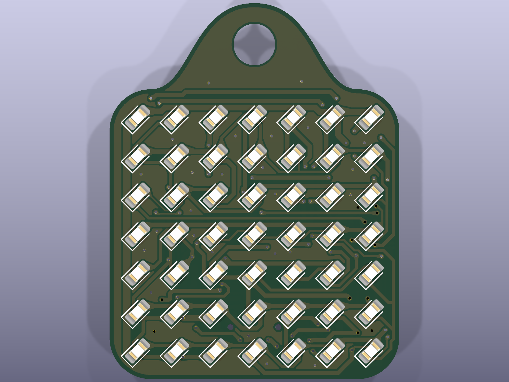
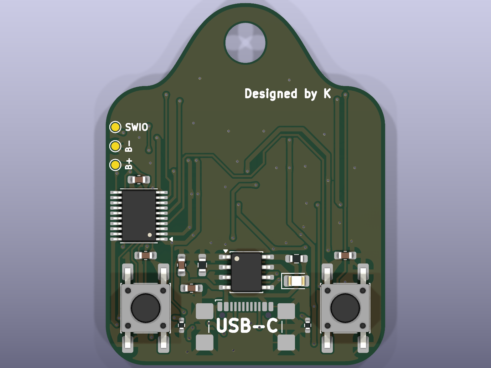
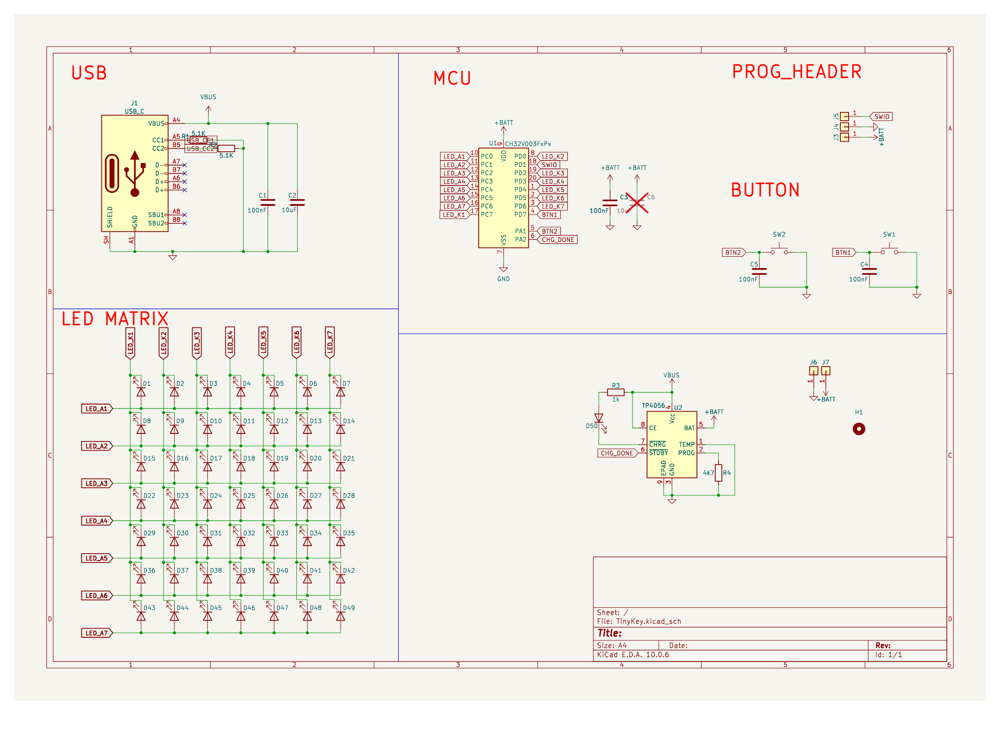

# TinyKey

A 7x7 LED keychain: **CH32V003F4P6**, USB-C, a LiPo charger, 49 LEDs behind
the front face and a 5 mm keyring hole. This repository contains the firmware
and the KiCad hardware.

```
  +-------------------+
  |  # # # # # # #    |   49 LEDs, row-scanned at ~570 Hz
  |  # # # # # # #    |   15-step software PWM dimming
  |  # # # # # # #    |   8 effects, 5x7 font, sleep mode
  |  # # # # # # #    |
  |  # # # # # # #    |
  |  # # # # # # #    |
  |  # # # # # # #    |
  +---------+---------+
          keyring
```



## Features

- 7x7 LED matrix multiplexed onto 14 GPIOs, scanned one row at a time
  (constant 7-step frame, ~1/7 duty, no visible flicker)
- Software PWM (15 levels) so effects can fade and the text scroll can move in
  sub-pixel steps
- 8 effects on the current sketch: text scroll, wave, ripple, rain, heart,
  bounce, chevron, animated face
- 5x7 font, 70 glyphs, UTF-8 aware (basic Latin + `à`)
- `BTN1` cycles effects, `BTN2` sleeps/wakes
- Runs off a single LiPo through a TP4056; USB-C is power-only

## Repository layout

| Path | What it is |
|---|---|
| `firmware/arduino/tinykey_v2/` | **main firmware** - Arduino sketch for the WCH core |
| `firmware/arduino/legacy/` | earlier sketches kept for reference (see its README) |
| `firmware/c/` | C firmware on ch32v003fun, 14 effects, ~3.3 kB |
| `bringup/` | six tiny sketches used to bring the first board up |
| `hardware/` | KiCad PCB + schematic, gerbers and the fab zip |
| `host/` | Windows helper to bind WinUSB to the WCH-Link |
| `tools/` | `flash.sh` / `verify.sh` for Linux and macOS |
| `prebuilt/` | ready-to-flash `.bin` files with checksums |
| `docs/` | hardware, option bytes and flashing notes |

## Quick start

You need a **WCH-Link** (or WCH-LinkE) on the 3-pin SWIO header and
`minichlink` - see [docs/flashing.md](docs/flashing.md). There is **no USB
bootloader**: the USB-C data pins are not connected to the MCU, so SWIO is the
only way in.

Flash the prebuilt main firmware:

```bash
timeout 30 minichlink -w prebuilt/tinykey_v2.bin flash -b
```

Build it yourself with the WCH Arduino core
(`WCH:ch32v:CH32V00x_EVT:pnum=CH32V003F4`):

```bash
arduino-cli compile --fqbn WCH:ch32v:CH32V00x_EVT:pnum=CH32V003F4 \
  --output-dir out firmware/arduino/tinykey_v2
timeout 30 minichlink -w out/tinykey_v2.ino.bin flash -b
```

Or build the C version (needs `riscv-none-elf-gcc` and
[ch32v003fun](https://github.com/cnlohr/ch32v003fun) cloned as a sibling
directory):

```bash
cd firmware/c
make            # or: powershell -File build.ps1
make flash
```

## Controls

| Button | Pin | Action |
|---|---|---|
| `BTN1` | PD7 | next effect |
| `BTN2` | PA1 | sleep / wake |

> **PD7 is NRST by default.** The board ships with the reset function enabled,
> so `BTN1` reboots the MCU instead of changing effect. The option bytes on the
> prototype were rewritten to `USER = 0x1F` (reset IO disabled) - see
> [docs/hardware.md](docs/hardware.md#pd7-is-nrst-by-default). Do this before
> wondering why the button "blinks an LED".

## Board quirks worth knowing

- All 49 front LEDs are soldered **backwards**; the firmware inverts the drive
  polarity (`POL_REVERSED` / reversed drive in the sketch). No desoldering.
- There are **no series resistors** on the matrix. Current is limited only by
  the 2 MHz GPIO drive setting - do not raise it to get a brighter display.
- `PD1` is SWIO. The matrix deliberately skips it (`K3` is on `PD2`).
- The first prototype's `BTN2` did not read reliably; sleep/wake is a bonus,
  not a requirement.

## Documentation

- [docs/hardware.md](docs/hardware.md) - pin map, polarity, current limits,
  option bytes, PCB revisions and gerbers
- [docs/flashing.md](docs/flashing.md) - WCH-Link, minichlink, WinUSB on
  Windows, verification and troubleshooting
- [firmware/arduino/README.md](firmware/arduino/README.md) - sketch features,
  text editing, legacy sketches
- [firmware/c/README.md](firmware/c/README.md) - C firmware, 14 effects
- [CHANGELOG.md](CHANGELOG.md) - how the board and firmware evolved
- [hardware/README.md](hardware/README.md) - board files, fabrication notes,
  how the renders are generated
- [docs/photos.md](docs/photos.md) - shot list for real photos of the board

## Pictures and fabrication files

| Front (49 LEDs) | Back (MCU, charger, buttons) |
|---|---|
|  |  |



- [Schematic (PDF)](docs/hardware/TinyKey-schematic.pdf)
- [Gerbers](hardware/gerbers) and the [fab zip](hardware/TinyKeyV2_gerbers.zip)
- The PCB pictures are 3D renders generated from `hardware/TinyKey.kicad_pcb`
  with `kicad-cli pcb render`, so they match the current board. They will be
  replaced by real photos of the assembled keychain; the shot list is in
  [docs/photos.md](docs/photos.md).

## Status

Personal prototype hardware, firmware works. `firmware/c` is the build that ran
on the first board; `tinykey_v2` is the newer Arduino rewrite and compiles at
8928 B of 16384 B flash. The prebuilt binaries are built from the sources here
(and the Arduino one rebuilds byte-for-byte), but check them on your own board
before trusting them.

## License

MIT - see [LICENSE](LICENSE).
